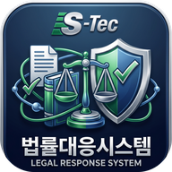

# Legal Response System (법률 대응 시스템)



**에스텍 그룹 법률 대응 시스템** · v1.1.1

정당한 Complaint 외에 현장에서 대응이 난감한 두 가지 사안을 다룹니다.

- **고객사의 부당·비합리적 클레임**: 근거 없는 근무자 교체·해고 요구, 업무범위 밖 지시, 일방적 대금 감액·계약 해지, 고객사 직원 갑질 등
- **근무자로 인해 발생한 사안**: 노동청 진정(임금·휴게시간), 수습 종료·계약 만료 다툼, 산재 신청·취하, 근무자 간 갈등, 비위 등

**① 발생 사업장 선정 → ② 사안 분류 → ③ 내용 작성 → ④ 법률 검토·출력** 순서로 처리하면 법적 쟁점, 관계 법령·판례(국가법령정보센터 원문 링크 포함), 당사 판단(수용 불가·조건부 수용·수용·적극 방어·협의), 대응 절차, 준비 서류, 회신·통지(안)을 **Word · PPT · PDF** 3종으로 만듭니다.

## 내려받기

| 구분 | 주소 |
|---|---|
| 웹 버전 | https://sadness500-boop.github.io/S-Tec-Legal-Response-System/ |
| 웹 버전 (버전별) | `releases/S-Tec-Legal-Response-System_v1.0.0.html` |
| 안드로이드 앱 (최신) | https://github.com/sadness500-boop/S-Tec-Legal-Response-System/releases/download/app-latest/stlr-latest.apk |

- **APK는 GitHub Actions가 만듭니다.** `index.html` 또는 `version.json`을 올리면 Actions 탭의 「Android APK」가 실행되어 약 5분 뒤 `releases/` 폴더와 릴리스에 APK가 올라갑니다.
- **웹 버전 주소를 열려면** 저장소 Settings › Pages › Branch를 `main` / `/(root)`로 한 번 켜야 합니다.

## 주요 기능

1. **상단 기능** (Complaint 프로그램과 동일): 법률대응 담당 지정, 다운로드 QR, 친구 추천, 내 계정(통합 로그인·관리자 페이지), 주간·야간·시스템 화면
2. **① 발생 사업장 선정**: 에스텍베스트 사업장 151곳 목록, 카카오맵 위치, 목록에 없으면 직접 입력
3. **② 사안 분류** (v1.1.0: 오른쪽 열로 옮겨 크게 표시 · 갈래별 탭): 6개 갈래 · 대분류 19 · 중분류 24 · 소분류 76
   - Ⅲ 사건·사고·배상: M 화재·시설·작업·범죄·주차·정보유출 사고 / N 배상·보험·급식 식중독·방역 피해
   - Ⅳ 계약·입찰·도급: P 불리 조항·부정당 제재·단가 / Q 불법파견·파견 기간·대금 회수·고용승계
   - Ⅴ 행정·인허가·감독: U 경비업 허가·배치·교육, 집단급식소, 소독업, 근로감독, 안전감독, 4대보험
   - Ⅵ 기타·대외·소송: Y 언론·온라인 게시물·소장·형사 고소 / Z 임금 압류·외국인 고용·유족 대응
   - Ⅰ 고객사 클레임: A 교체·인사 개입 / B 업무범위 외 지시 / C 계약·대금·손해배상 / D 고객사 직원 갑질·폭언·성희롱 / E 사고 책임 전가·부당 요구
   - Ⅱ 근무자 사안: F 노동청 진정·임금 / G 해고·계약종료·수습 / H 산업재해 / I 갈등·괴롭힘 / J 비위·형사 / K 근태·인사명령 / L 노동조합
4. **대표 사례로 바로 시작**: 부산 일본영사관 갑질 대응, GMB 보안팀 갈등 인사조치, 대한제강 경비원 B 산재 철회·복직, 노동청 휴게시간 진정, 수습 종료 통보, 계약 해지와 고용 종료
5. **④ 법률 검토 출력**: 주요 보고내용, 사안 개요·사업장 정보, 사실관계, 법적 쟁점, 관계 법령·판례(law.go.kr 원문 링크), 당사 법적 판단표, 대응 방안(D+0 / D+1~14 / 재발방지), 준비 서류 체크리스트, 리스크·내부 유의사항(내부용만), 실행 일정(D+0~D+30), 고객사 회신 또는 근로자 통지(안)
6. **내부 검토용 / 대외 제출용** 구분: 대외용에는 위험도·리스크 평가·근무자 징계 내용이 들어가지 않습니다.
7. **⑤ 근무자 조치 문서**: 갈등·비위·근태 등 근무자 귀책 사안일 때만 나타나며, 징계 양정·절차·서식을 별도 Word·PPT·PDF로 출력합니다.
8. 공문·메일·카톡·진정서 파일 불러오기(글자 인식), 출력 기록 관리

## 매뉴얼 (docs/)

| 문서 | Word | PPT | PDF |
|---|---|---|---|
| 사용자 매뉴얼 | [docx](docs/S-Tec-Legal-Response-System_사용자매뉴얼_v1.0.0.docx) | [pptx](docs/S-Tec-Legal-Response-System_사용자매뉴얼_v1.0.0.pptx) | [pdf](docs/S-Tec-Legal-Response-System_사용자매뉴얼_v1.0.0.pdf) |
| 제작자 관리 사용매뉴얼 | [docx](docs/S-Tec-Legal-Response-System_제작자관리매뉴얼_v1.0.0.docx) | [pptx](docs/S-Tec-Legal-Response-System_제작자관리매뉴얼_v1.0.0.pptx) | [pdf](docs/S-Tec-Legal-Response-System_제작자관리매뉴얼_v1.0.0.pdf) |

## 통합 로그인 · 프로그램별 권한

- `auth-config.json`이 근태관리·Complaint 프로그램과 **같은 Supabase 서버**를 가리킵니다. 하나의 아이디로 사용합니다.
- **처음 한 번:** Supabase SQL Editor에서 [`server/supabase_app_access_stlr.sql`](server/supabase_app_access_stlr.sql) 실행 → 관리자 페이지 「🔐 프로그램별 권한」에서 사용자별 「법률 대응」 사용 권한을 지정합니다. (제작자·관리자는 바로 사용)

## 법령 기준

- 모든 법령은 **국가법령정보센터(https://www.law.go.kr)** 현행 법령 기준으로 요약했고, 문서마다 조문 원문 링크를 넣었습니다(2026.11 기준: 개정 노동조합법 제2·3조 2026. 3. 10. 시행, 최저임금 2026년 10,320원 · 2027년 10,700원 반영).
- 판례는 대법원 판례 번호와 판례검색 링크를 함께 적었습니다.
- ※ 법령·판례 요약은 실무 참고용이며 법률 자문을 대체하지 않습니다. 중요 사안은 적용 전에 원문을 확인하고 공인노무사·변호사 자문을 받으십시오.

## 파일 구성

```
index.html                       프로그램 전체 (한 파일, 라이브러리 내장)
releases/                        버전별 HTML · APK
source/                          원본: kb.js(사안 분류·법령·판례) · app.js · ui.js · worker.js · intake.js · sites.js · build.py
source/vendor/                   빌드용 라이브러리·이미지 (python3 source/build.py 로 index.html 생성)
server/supabase_app_access_stlr.sql   프로그램별 권한에 법률 대응(stlr) 추가
icons/ · manifest.webmanifest · sw.js  앱 아이콘 · 홈 화면 설치(PWA)
.github/workflows/android-apk.yml      안드로이드 앱 자동 빌드
```

## 변경 이력

- **v1.1.1** (2026-11-19): 상단 제목 아래 안내 글씨 삭제, 아이콘·프로그램 명칭을 상단 카드와 같은 높이(가운데)로 배치
- **v1.1.0** (2026-11-19): ② 사안 분류 확대(오른쪽 열·갈래별 탭), 사례 카드 축소, 사안 4개 갈래 30개 항목·법령 26개 추가(총 76개·115개), 대표 사례 2건(한국제지 화재·한국하우톤 조리원 파견) 추가, 회신(안) 3종(고객사·근로자·관계기관)
- **v1.0.0** (2026-11-18): 최초 버전. Complaint 대응 프로그램 디자인·기본 구조 기반, 사안 46개 · 법령·판례 89개, Word·PPT·PDF 출력

---
Designed & Developed by **Rat Rae Choi**
